<p align="center">
  <picture>
    <source media="(prefers-color-scheme: dark)" srcset="assets/es/hero-dark.svg">
    
  </picture>
</p>

<p align="center"><a href="README.md">English</a> · <b>Español</b></p>

<h1 align="center">themis: un solo archivo de reglas para todos los agentes</h1>

<p align="center"><b>CLAUDE.md y AGENTS.md, breves e idénticos, sin sincronizarlos a mano.</b></p>

<p align="center">
  
  
  
  
</p>

<p align="center"><a href="#qué-hace">Qué hace</a> · <a href="#cómo-pasa-una-edición">Cómo funciona</a> · <a href="#instalación">Instalación</a> · <a href="#úsalo">Úsalo</a> · <a href="#opciones">Opciones</a> · <a href="#qué-se-midió">Resultados</a> · <a href="#límites">Límites</a></p>

---

**themis es un plugin de Claude Code para los archivos de reglas que leen los agentes de código.** Claude Code lee `CLAUDE.md`; Codex, Cursor, Copilot y otros leen `AGENTS.md`. Si nadie los cuida, los dos se separan, y cada corrección añade una línea que cuesta tokens en todas las sesiones. themis te da una skill que los escribe y los poda, y tres hooks que copian cada edición al otro archivo, mantienen los dos por debajo de unos 2500 tokens y revisan cada regla nueva contra el repositorio.

## Qué hace

- **Un texto en dos archivos.** Cuando Claude edita `CLAUDE.md` o `AGENTS.md`, un hook copia el archivo sobre su gemelo, byte a byte. Una herramienta que lee solo uno de los dos recibe el texto completo.
- **Un tope de tamaño.** Se deniega la edición que llevaría un archivo de reglas por encima de unos 2500 tokens, contando los imports `@path`, con instrucciones para condensar.
- **Diferencias avisadas, nunca resueltas por ti.** Si alguien cambió un archivo fuera de Claude, themis lo dice y te pregunta qué texto vale.
- **Un gate para reglas nuevas.** Comprobaciones fijas, sin modelo, marcan la regla que el repositorio ya muestra, la que ya impone una herramienta, el consejo genérico, la prohibición que debería ser un hook, el procedimiento largo y las mayúsculas a gritos.
- **Una sola skill.** `/themis:themis` crea, audita, edita y sincroniza el par.

## Cómo pasa una edición

<p align="center"><picture>
  <source media="(prefers-color-scheme: dark)" srcset="assets/es/readme/cap-dark.svg">
  
</picture></p>

1. Claude llama a `Edit`, `Write` o `MultiEdit` sobre `CLAUDE.md`, `AGENTS.md` o `CLAUDE.local.md`.
2. El hook `PreToolUse` mide el resultado. Si pasa del tope, deniega la edición y Claude condensa: fusiona líneas que repiten un mismo patrón o mueve un procedimiento largo a un doc y deja un puntero. También deniega la edición de un par que ya difiere, y te pregunta qué texto vale.
3. El gate juzga las reglas nuevas. Por defecto la edición sigue adelante y Claude te dice qué marcó y por qué.
4. La edición entra y el hook `PostToolUse` copia el archivo sobre su gemelo, así el par sigue idéntico byte a byte.
5. Al empezar cada sesión, el hook `SessionStart` revisa cada par del proyecto y avisa de los que difieren.

Las escrituras desde la shell a un archivo de reglas (`>`, `tee`, `sed -i`, `Set-Content` y similares) se deniegan, así que el tope no se salta desde la shell. Qué cubre la paridad, archivo por archivo, está en [docs/hooks.md](docs/hooks.md) (en inglés).

## Instalación

```text
/plugin marketplace add ilien-dev/themis
/plugin install themis@themis
```

> [!IMPORTANT]
> Los hooks son scripts de Node. Necesitan Node.js 18 o posterior en el `PATH`; la instalación no compila nada.

Después ejecuta `/themis:themis` una vez en cada repositorio. Crea el archivo que falte de los dos, o audita los que ya tienes.

<details><summary><b>Actualizar, usar un clon local o venir de 1.x</b></summary>

- Para actualizar: `/plugin marketplace update themis` y luego `/plugin update themis@themis`. La actualización automática viene apagada en los marketplaces de terceros; actívala en `/plugin`.
- Para una sola sesión desde un clon local: `claude --plugin-dir <ruta-al-clon>`.
- La versión 2.0.0 quitó cinco skills; las notas de migración están en [CHANGELOG.md](CHANGELOG.md).

</details>

## Úsalo

<p align="center"><picture>
  <source media="(prefers-color-scheme: dark)" srcset="assets/es/readme/audit-dark.svg">
  
</picture></p>

`/themis:themis [init | audit | sync]`. Claude también carga la skill por su cuenta antes de crear o editar un archivo de reglas.

| Modo | Qué hace |
|---|---|
| `init` | Lee el manifiesto, los scripts, la CI y algunos archivos de código, ejecuta los comandos de test y build, y escribe solo las líneas que el modelo haría mal sin ellas. |
| `audit` | Marca cada línea keep, cut, move, rewrite o conflict, muestra la tabla y la estimación de tokens, y aplica lo que apruebes. |
| *editar* | Sin argumento: lo que hace la skill cuando Claude cambia un archivo de reglas en medio de otro trabajo. Añade lo pedido en la forma más corta. |
| `sync` | Deja el par idéntico otra vez: crea el archivo que falta, o enseña la diferencia y pregunta qué texto vale. |

Conserva los comandos que nadie adivinaría, las convenciones que se apartan del framework, las trampas y los punteros a docs. Quita los resúmenes del proyecto, lo que el código ya muestra, los consejos genéricos y los procedimientos largos, que pasan a un doc.

## Opciones

Son las opciones `userConfig` del plugin, declaradas en `.claude-plugin/plugin.json`.

| Opción | Por defecto | Qué hace |
|---|---|---|
| `claude_md_cap` | `2500` | Tokens estimados como máximo para un archivo de reglas con sus imports. `0` apaga el tope. |
| `parity` | `true` | Copia las ediciones entre `CLAUDE.md` y `AGENTS.md` y avisa de los pares que difieren. |
| `gate` | `report` | Qué hacer con una regla marcada: `report` (avisa a Claude sin interrumpir), `ask` (confirmas tú) u `off`. |
| `gate_paths` | `false` | Marca también una línea como "`src/x.ts`: parses the CSV" cuyas palabras salen todas de ese archivo. |

Cada comprobación del gate, sus veredictos, el archivo de reglas aceptadas y la línea de comandos de `gate.js` están en [docs/gate.md](docs/gate.md) (en inglés).

## Qué se midió

Sesiones sin interfaz en `claude-opus-5-5`, tres ejecuciones por caso, repositorios nuevos, según [RESULTS.md](RESULTS.md):

| Caso | Sin themis | Con themis |
|---|---:|---:|
| `init` escribe un archivo breve con las trampas reales | 0/3 | 3/3 |
| `audit` poda un archivo inflado y corrige comandos obsoletos | 0/3 | 3/3 |
| Un añadido cerca del tope se queda por debajo | 0/3 | 3/3 |

*Sin themis* es la misma petición a Claude Code sin el plugin (`/init` en el caso de `init`). Sobre 1223 reglas de 40 repositorios públicos, el gate tal como se publica marca 81 reglas para interrumpir en modo `ask`, el 84 % con razón. Eso es la precisión: de todas las reglas redundantes, detecta más o menos una de cada cinco. La cifra se midió después de un ajuste, no a ciegas, y las etiquetas aún no se han revisado; la medición a ciegas y sus salvedades están en [RESULTS.md](RESULTS.md).

## Preguntas

<details><summary><b>¿Qué archivo lee Claude Code?</b></summary>

Desde Claude Code v2.1.277, lee `AGENTS.md` solo cuando no hay `CLAUDE.md` ni `CLAUDE.local.md`. Con el par que mantiene themis, lee `CLAUDE.md`, y `AGENTS.md` queda para las demás herramientas. Las versiones anteriores nunca leen `AGENTS.md`. Fuente: la [documentación de memoria](https://code.claude.com/docs/en/memory).

</details>

<details><summary><b>¿Se cargan las reglas dos veces?</b></summary>

No por defecto. Si pones **Project instructions** en `claude-md-and-agents-md` en `/config`, Claude Code carga los dos archivos y las reglas cuestan el doble de tokens. Con themis, deja ese ajuste como viene.

</details>

<details><summary><b>¿Por qué dos copias y no un enlace simbólico o un import <code>@AGENTS.md</code>?</b></summary>

Así una herramienta que lee solo uno de los archivos recibe el texto completo, en cualquier sistema. Un par enlazado se deja como está y se avisa; `sync` ofrece convertirlo en dos copias.

</details>

<details><summary><b>¿Y si edito un archivo en mi editor?</b></summary>

Los hooks solo ven las llamadas a herramientas de Claude, así que nada te lo impide. La diferencia se avisa al empezar la siguiente sesión, o la próxima vez que Claude toque los archivos, y Claude te pregunta qué texto vale.

</details>

## Límites

- **El gate lee proyectos de Node.** Sus comprobaciones usan `package.json`; en otros repositorios no encuentran pruebas y conservan la regla.
- **Inglés y español.** Las tablas de frases del gate cubren esos dos idiomas.
- **El gate deja pasar casi todo lo redundante.** Detecta más o menos una de cada cinco; lo que marca suele estar bien. Sus cifras son provisionales.
- **Tope y paridad sirven en cualquier repo.** Solo el gate depende de `package.json`.
- **Solo se bloquean las llamadas de Claude.** Los cambios desde tu editor, git, `cp` o `mv` se avisan después, no se impiden.

La lista completa, con las mediciones, está en [docs/gate.md](docs/gate.md#limits) (en inglés).

## Desarrollo

Los tests necesitan Node.js 22.18 o posterior, y el lint también revisa `assets/`, así que instala ahí también:

```bash
npm ci && (cd assets/source && npm ci) && (cd assets/motion/source && npm ci)
npm run check    # typecheck, lint, build y test, en ese orden
```

Los hooks son TypeScript estricto en `hooks/*.ts`, compilado a `hooks/dist/`, que se versiona porque Claude Code ejecuta un plugin directamente desde su repositorio. La CI falla si `hooks/dist/` no coincide con su fuente. Para publicar, sube `version` en `.claude-plugin/plugin.json` y `package.json` y añade una sección a `CHANGELOG.md`; la CI crea la etiqueta y la release cuando llega a `main`.

## Licencia

MIT, ver [LICENSE](LICENSE). El logo y las imágenes se describen en [assets/README.md](assets/README.md).
