<p align="center">
  <picture>
    <source media="(prefers-color-scheme: dark)" srcset="assets/hero-dark.svg">
    
  </picture>
</p>

<p align="center"><b>English</b> · <a href="README.es.md">Español</a></p>

<h1 align="center">themis: one rule file for every coding agent</h1>

<p align="center"><b>CLAUDE.md and AGENTS.md, short and identical, without keeping them in step by hand.</b></p>

<p align="center">
  
  
  
  
</p>

<p align="center"><a href="#what-it-does">What it does</a> · <a href="#how-an-edit-goes-through">How it works</a> · <a href="#install">Install</a> · <a href="#use-it">Use it</a> · <a href="#options">Options</a> · <a href="#what-was-measured">Results</a> · <a href="#limits">Limits</a></p>

---

**themis is a Claude Code plugin for the rule files coding agents read.** Claude Code reads `CLAUDE.md`; Codex, Cursor, Copilot and others read `AGENTS.md`. Left alone, the two drift apart, and every correction adds a line that costs tokens in every session. themis gives you one skill that writes and prunes them, and three hooks that copy each edit to the other file, hold both under about 2,500 tokens and check each new rule against the repository.

## What it does

- **One text in two files.** After Claude edits `CLAUDE.md` or `AGENTS.md`, a hook copies it over its twin, byte for byte. A tool that reads only one of them still gets the whole text.
- **A size cap.** An edit that would take a rule file past about 2,500 tokens, `@path` imports included, is denied with instructions to condense.
- **Differences reported, never resolved for you.** When someone changed one file outside Claude, themis says so and asks which text is right.
- **A gate for new rules.** Fixed checks, with no model, flag a rule the repository already shows, a tool already enforces, generic advice, a ban that belongs in a hook, a long procedure or shouting.
- **One skill.** `/themis:themis` creates, audits, edits and syncs the pair.

## How an edit goes through

<p align="center"><picture>
  <source media="(prefers-color-scheme: dark)" srcset="assets/readme/cap-dark.svg">
  
</picture></p>

1. Claude calls `Edit`, `Write` or `MultiEdit` on `CLAUDE.md`, `AGENTS.md` or `CLAUDE.local.md`.
2. The `PreToolUse` hook measures the result. Over the cap, the edit is denied and Claude condenses: it merges lines that repeat one pattern, or moves a long procedure to a doc and leaves a pointer. An edit to a pair that already differs is denied too, and you are asked which text is right.
3. The rule gate judges the new rules. By default the edit goes through and Claude tells you what was flagged and why.
4. The edit lands, and the `PostToolUse` hook copies the file over its twin, so the pair stays byte for byte the same.
5. At every session start, the `SessionStart` hook checks each pair in the project and reports the ones that differ.

Shell writes to rule files (`>`, `tee`, `sed -i`, `Set-Content` and the like) are denied, so the cap cannot be skipped from the shell. What parity covers, file by file, is in [docs/hooks.md](docs/hooks.md).

## Install

```text
/plugin marketplace add ilien-dev/themis
/plugin install themis@themis
```

> [!IMPORTANT]
> The hooks are Node scripts. They need Node.js 18 or later on `PATH`; nothing is built at install.

Then run `/themis:themis` once in each repository. It creates whichever of the two files is missing, or audits the ones you have.

<details><summary><b>Updates, a local clone, and coming from 1.x</b></summary>

- Updates: `/plugin marketplace update themis`, then `/plugin update themis@themis`. Auto-update is off by default for third-party marketplaces; turn it on in `/plugin`.
- For one session from a local clone: `claude --plugin-dir <path-to-clone>`.
- Version 2.0.0 removed five skills; the migration notes are in [CHANGELOG.md](CHANGELOG.md).

</details>

## Use it

<p align="center"><picture>
  <source media="(prefers-color-scheme: dark)" srcset="assets/readme/audit-dark.svg">
  
</picture></p>

`/themis:themis [init | audit | sync]`. Claude also loads the skill by itself before it creates or edits a rule file.

| Mode | What it does |
|---|---|
| `init` | Reads the manifest, scripts, CI and a few source files, runs the test and build commands, and writes only the lines the model would get wrong without. |
| `audit` | Marks every line keep, cut, move, rewrite or conflict, shows the table and the token estimate, then applies what you approve. |
| *edit* | No argument: what the skill does when Claude changes a rule file during other work. It adds what was asked in the shortest form. |
| `sync` | Brings a pair back to identical: creates the missing file, or shows the difference and asks which text is right. |

It keeps commands nobody could guess, conventions that differ from the framework default, gotchas and pointers to docs. It cuts overviews, what the code already shows, generic advice and long procedures, which move to a doc.

## Options

They are the plugin's `userConfig` options, declared in `.claude-plugin/plugin.json`.

| Option | Default | What it does |
|---|---|---|
| `claude_md_cap` | `2500` | Maximum estimated tokens for a rule file with its imports. `0` turns the cap off. |
| `parity` | `true` | Copy edits between `CLAUDE.md` and `AGENTS.md` and report pairs that differ. |
| `gate` | `report` | What to do with a flagged rule: `report` (tell Claude, do not interrupt), `ask` (you confirm) or `off`. |
| `gate_paths` | `false` | Also flag a line such as "`src/x.ts`: parses the CSV" whose words all come from that file. |

Every check of the gate, its verdicts, the accepted-rules file and the `gate.js` command line are in [docs/gate.md](docs/gate.md).

## What was measured

Headless sessions on `claude-opus-5-5`, three runs per cell, fresh repositories, from [RESULTS.md](RESULTS.md):

| Case | Without themis | With themis |
|---|---:|---:|
| `init` writes a lean file with the real gotchas | 0/3 | 3/3 |
| `audit` prunes a bloated file and fixes stale commands | 0/3 | 3/3 |
| An addition near the cap stays under it | 0/3 | 3/3 |

*Without themis* is the same request to plain Claude Code (`/init` for `init`). On 1,223 rules from 40 public repositories, the gate as shipped flags 81 rules for an interruption in `ask` mode, 84% of them rightly. That is precision: of all the redundant rules, it catches about one in five. The figure was measured after a fix, not blind, and the labels are not reviewed yet; the blind run and its caveats are in [RESULTS.md](RESULTS.md).

## Questions

<details><summary><b>Which file does Claude Code read?</b></summary>

Since Claude Code v2.1.277, it reads `AGENTS.md` only when there is no `CLAUDE.md` or `CLAUDE.local.md`. With the pair themis keeps, it reads `CLAUDE.md`, and `AGENTS.md` is there for the other tools. Earlier versions never read `AGENTS.md`. Source: the [memory documentation](https://code.claude.com/docs/en/memory).

</details>

<details><summary><b>Are the rules loaded twice?</b></summary>

Not by default. If you set **Project instructions** to `claude-md-and-agents-md` in `/config`, Claude Code loads both files, and the rules cost twice the tokens. Leave that setting on its default with themis.

</details>

<details><summary><b>Why two copies, not a symlink or an <code>@AGENTS.md</code> import?</b></summary>

A tool that reads only one of the files gets the whole text, on every platform. A linked pair is left as it is and reported; `sync` offers to turn it into two copies.

</details>

<details><summary><b>What if I edit one file in my editor?</b></summary>

The hooks see only Claude's tool calls, so nothing stops you. The difference is reported at the next session start, or the next time Claude touches the files, and Claude asks you which text is right.

</details>

## Limits

- **The gate reads Node projects.** Its checks use `package.json`; in other repositories they find no evidence and keep the rule.
- **English and Spanish.** The gate's phrase tables cover those two languages.
- **The gate misses most redundant rules.** It catches about one in five; what it flags is usually right. Its numbers are provisional.
- **The cap and parity work in any repository.** Only the gate depends on `package.json`.
- **Only Claude's tool calls are blocked.** Changes from your editor, git, `cp` or `mv` are reported afterwards, not stopped.

The full list, with the measurements behind it, is in [docs/gate.md](docs/gate.md#limits).

## Development

The tests need Node.js 22.18 or later, and the lint also covers `assets/`, so install there too:

```bash
npm ci && (cd assets/source && npm ci) && (cd assets/motion/source && npm ci)
npm run check    # typecheck, lint, build and test, in that order
```

The hooks are strict TypeScript in `hooks/*.ts`, compiled to `hooks/dist/`, which is committed because Claude Code runs a plugin straight from its repository. CI fails when `hooks/dist/` does not match its source. To release, raise `version` in `.claude-plugin/plugin.json` and `package.json` and add a section to `CHANGELOG.md`; CI tags and publishes it once it reaches `main`.

## License

MIT, see [LICENSE](LICENSE). The logo and pictures are described in [assets/README.md](assets/README.md).
