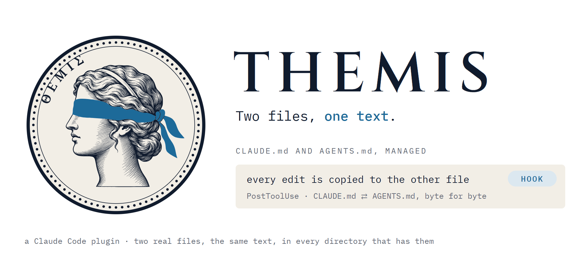
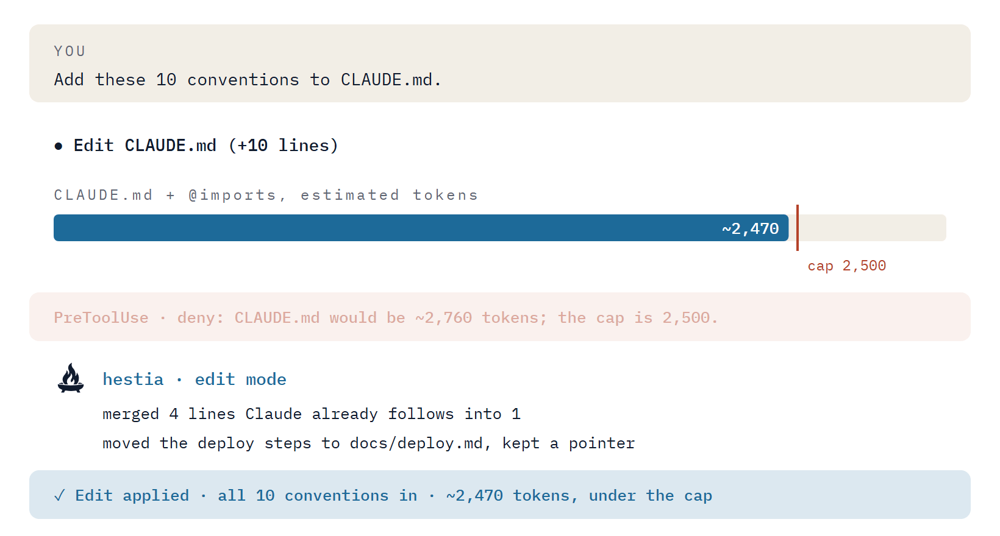
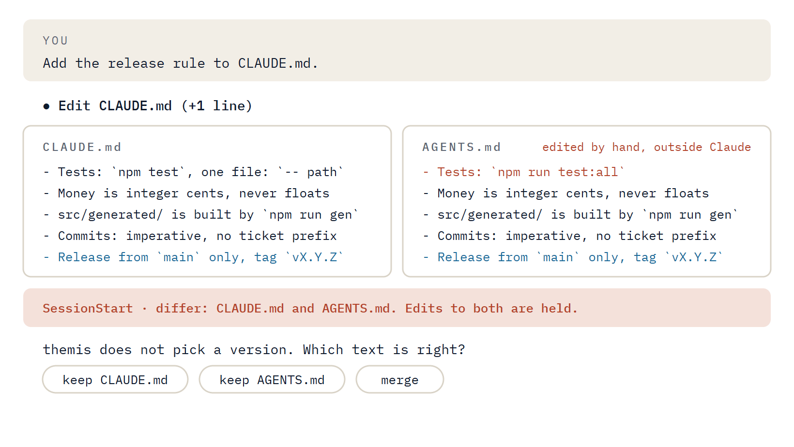

<p align="center">
  <picture>
    <source media="(prefers-color-scheme: dark)" srcset="assets/motion/hero-dark.gif">
    
  </picture>
</p>

<h1 align="center">themis</h1>

A Claude Code plugin that manages a repository's rule files, `CLAUDE.md` and `AGENTS.md`. It keeps them short, and it keeps the two identical.

## The problem

Rule files go wrong in two ways.

**They grow.** Every correction becomes another line, and nobody removes the lines the model would follow anyway. A long file costs tokens in every session and buries the few lines that matter: the test command that isn't guessable, the generated directory that must not be edited.

**They fork.** Claude Code reads `CLAUDE.md`. Codex, Cursor, Copilot and others read `AGENTS.md`. A repository that wants both ends up with two files that someone has to keep in step by hand, and one of them is always a few edits behind.

themis handles both with one skill and three hooks, and a gate that checks each new rule before it goes in.

## Which file Claude Code reads

As of Claude Code v2.1.277, from the [memory documentation](https://code.claude.com/docs/en/memory):

| The repository has | Claude Code reads |
|---|---|
| `AGENTS.md` and no `CLAUDE.md` or `CLAUDE.local.md` in the working directory or above it | `AGENTS.md` |
| `AGENTS.md` and a `CLAUDE.md` or `CLAUDE.local.md` | the `CLAUDE.md` files only |

So with the pair themis maintains, Claude Code reads `CLAUDE.md` and ignores `AGENTS.md`, which is there for every other tool. Nothing is loaded twice.

One setting changes that. If you set **Project instructions** to `claude-md-and-agents-md` in `/config`, Claude Code loads both files. It skips an `AGENTS.md` that `CLAUDE.md` imports or symlinks to, but two separate identical files are both loaded, and the rules cost twice the tokens. Leave the setting on its default with themis.

Versions before v2.1.277 never read `AGENTS.md` on their own.

## The skill

`/themis:themis [init | audit | sync]`. Claude also loads it by itself before it creates or edits a `CLAUDE.md`, `AGENTS.md` or `CLAUDE.local.md`, so its description (about 125 tokens) stays in context.

| Mode | What it does |
|---|---|
| `init` | Reads the manifest, scripts, CI config and a few source files, runs the test and build commands it finds, and writes a file with only the lines that pass one test: *would the model make a mistake in this repo without it?* |
| `audit` | Checks every line and command of the existing files against the repo and marks each keep, cut, fix or move. Shows the table, then applies what you approve. |
| edit | The default when Claude is about to change a rule file in the middle of other work. Adds what was asked in the shortest form, and condenses nearby lines when the result would pass the cap. It does not audit the rest. |
| `sync` | Brings a pair back to identical: creates the missing file, or shows how two files differ and asks you which text is right. |

What it keeps: commands that aren't guessable, conventions that differ from the framework default, gotchas, repo etiquette, and pointers to docs. What it cuts: project overviews, anything the code already shows, generic advice, rules the model follows anyway, and long procedures (those move to a doc, with a pointer).

## The size cap

<p align="center">
  <picture>
    <source media="(prefers-color-scheme: dark)" srcset="assets/motion/cap-dark.gif">
    
  </picture>
</p>

An `Edit`, `Write` or `MultiEdit` that would take `CLAUDE.md`, `AGENTS.md` or `CLAUDE.local.md` past about 2,500 tokens is denied, with instructions to condense instead. Files pulled in with `@path` count toward the total. An edit that shrinks a file already over the cap is allowed.

Shell commands that write to those files (`>`, `>>`, `tee`, `sed -i`, `perl -i`, `Set-Content`, `Add-Content`, `Out-File`) are denied, so the cap can't be bypassed from the shell.

2,500 tokens is the size Boris Cherny reports for his own CLAUDE.md; the official guidance is "under 200 lines". The estimate is characters ÷ 3.6. Configure it with `claude_md_cap` (0 disables it).

## Parity

<p align="center">
  <picture>
    <source media="(prefers-color-scheme: dark)" srcset="assets/motion/parity-dark.gif">
    
  </picture>
</p>

`CLAUDE.md` and `AGENTS.md` in the same directory are two real files with the same bytes. Not an `@AGENTS.md` import and not a symlink: a tool that reads only one of them gets the whole text.

**Edits are copied.** After Claude edits either file, a `PostToolUse` hook copies it over the other one, byte for byte, and creates the other one if it doesn't exist. Claude edits one file; there is no second step to forget.

**A difference is never resolved for you.** If the two files already differ when Claude tries to edit one, somebody changed one of them outside themis: in an editor, with `git checkout`, in a merge. Copying would silently discard one side, so the `PreToolUse` hook stops instead:

- `Edit` and `MultiEdit` are denied. Claude is told which two files differ and to ask you which text is right.
- `Write`, which replaces the whole file, raises a permission prompt that says both files will get this text. This is how a difference gets resolved: the skill shows you the diff, you choose one side or a merge, and you approve the write. In an unattended `claude -p` run nobody can answer the prompt, so the write is denied and the difference stays for a person to resolve.
- Creating the missing file of a pair is allowed only as an exact copy of the one that exists.

**Differences are reported.** At session start, and after any shell command that names one of the files, themis checks every pair in the project: the working directory up to the repository root, and every directory below it (from `git ls-files`, so ignored directories are skipped). Outside a git repository it checks the working directory only, so a session opened in your home directory says nothing about the projects under it. A directory with only one of the two files is not reported. If all pairs match it says nothing. Otherwise Claude gets one line per pair, such as `differ: CLAUDE.md (modified 2026-10-08 07:59 UTC) and AGENTS.md (modified 2026-10-07 18:02 UTC)`, with the instruction to tell you and not to choose a version.

What parity covers:

| File | Cap | Parity |
|---|---|---|
| `CLAUDE.md` ⇄ `AGENTS.md`, in the repository root and any subdirectory | yes | yes |
| `.claude/CLAUDE.md` ⇄ `.claude/AGENTS.md` in a project | yes | yes |
| `CLAUDE.local.md` | yes | no. It is personal and uncommitted, and no tool reads an `AGENTS.local.md` |
| `~/.claude/CLAUDE.md` and the managed-policy `CLAUDE.md` | yes | no. Those directories belong to Claude Code |
| A pair linked by an `@AGENTS.md` import or a symlink | yes | left as it is and reported; `sync` offers to turn it into two copies |

Limits worth knowing:

- The hooks see Claude's tool calls. A change made in your editor or by git is not blocked; it is reported at the next session start, or the next time Claude touches the files.
- The shell block matches common write commands, not every program that can write a file. What it misses is caught by the report after the command.
- Outside a git repository the check walks four directory levels below the working directory.

Turn parity off with the `parity` option if you want only one of the two files; the cap keeps working.

## The rule gate

The skill used to decide by judgment what belongs in a rule file, so the same rule could be accepted one day and cut the next. The gate decides with fixed checks instead: no model, the same answer every time. It reads the repository's `package.json`, lint and TypeScript configuration, CI and hook files, README and docs, and judges each new rule against them.

A rule is a list item with its continuation lines, a paragraph, a numbered list or a code block with the paragraph that introduces it. Six questions are active:

| # | Question | Verdict |
|---|---|---|
| 1 | Does the repo already show it? A project title, a folder tree, "use X" for a dependency that is the only one of its kind, a script with an obvious name and nothing added, a summary of the README. | `cut` |
| 2 | Does a tool already enforce it? A lint or compiler setting that is configured, run by a script, a pre-commit hook or CI, with the same value; or a `permissions.deny` rule that covers the command. If the setting says the opposite, `conflict`. | `cut` or `conflict` |
| 3 | Is it generic or filler? "Write clean code", "this file provides guidance", or a phrase a vendor guide for a current model asks to remove. English and Spanish. | `cut` |
| 5 | Is it an absolute ban on a command or path? "Never run `x`" is better as a hook or a `permissions.deny` rule. | `move` |
| 6 | Is it a long procedure, or a passage copied from the README or `docs/`? | `move`, to a doc or a skill with a pointer |
| 7 | Is it shouted, or does it name a command or path that does not exist? | `rewrite` or `fix` |

Everything else is `keep`. A `keep` can carry a note (no evidence found, no anchor in the repo, an absolute without a reason); a note informs and never interrupts. A rule is kept when in doubt: a negation, a condition, a number or a word the tables do not know all count as information.

Negative rules ("don't use X") are never cut by question 1, and "use pnpm, not npm" is kept even with a `pnpm-lock.yaml`, because naming a tool that is not the default changes what the model does.

### Modes

The `gate` option sets what happens when a rule written to `CLAUDE.md` or `AGENTS.md` gets a verdict other than `keep`.

| `gate` | What happens |
|---|---|
| `report` (default) | The edit goes through. Claude is shown the verdicts and told to tell you which rules were flagged and why. It may repair a `fix` or `rewrite` itself, but removes or moves a rule only after telling you. |
| `ask` | The edit stops and you are asked. The prompt lists each rule with its verdict, reason and evidence; approving writes the rule as given. |
| `off` | The gate does nothing. |

The default is `report` because the gate has not earned the right to interrupt you: see [RESULTS.md](RESULTS.md) for its measured precision.

The gate never denies an edit. In sessions where nobody can answer a prompt (permission mode `dontAsk` or `bypassPermissions`, subagents), `ask` falls back to `report`. A headless `claude -p` session cannot be recognized from the hook input, so there `ask` is denied by Claude Code and Claude reads the reason.

### Accepted rules

When you approve a rule that the gate had flagged, themis records it in `.claude/themis-accepted.json`, which belongs in version control: the hash of the normalized text, the original verdict and the date. From then on that rule is `keep` with an `accepted` note, in the hook and in `audit`. If its text changes, the hash changes and it is judged again. `gate audit --prune` removes entries that no longer match any rule. Nothing is recorded in `report` mode, because nobody approved anything, nor outside a git repository, where there is no project to record it in.

### Command line

The skill calls these; you can too.

```
node hooks/dist/gate.js check  [--file CLAUDE.md] [--json]   # Markdown on stdin; --file says which repository
node hooks/dist/gate.js audit  <file> [--json] [--prune]     # a verdict for every rule, and the coverage
node hooks/dist/gate.js report <corpus.jsonl> [--json]       # precision, false-cut rate and coverage of a labelled corpus
```

The exit code is 0 for any valid input and 2 for wrong usage or an unreadable file.

### Limits

- **Node, JavaScript and TypeScript repositories only.** The checks read `package.json`; elsewhere they find no evidence and keep the rule.
- **English and Spanish.** The phrase tables cover those two languages.
- **The model-default question is not active.** "Do recent models already do this by default?" needs measured data per model; it is planned next, and until then the gate does not cut a rule for that reason.
- **Monorepos.** A script or path that lives in a sub-package can look missing from the root. The gate does not report a missing script when the repository has more than one `package.json`, and counts a path as present when a tracked path ends with it, so in a monorepo a reference that really is dead can go unreported.
- **Node versions.** The compiled hooks run on Node.js 18. Contributors need Node.js 22.18 or later to run the tests, which execute the TypeScript sources.
- **Measured blind on 1,502 rules from 40 public repositories**: of 150 interruptions, 62.0% deserved some interruption and 50.7% (76 of 150) got the same verdict as the label; 6.3% of the rules labelled keep were interrupted. The checks were then corrected on what that run showed; on the same corpus they now interrupt 65 rules with 87.7% deserving it and 0.9% of keeps interrupted, an upper bound rather than a validation. They flag about one in ten of the rules that should go. The labels are not yet reviewed, so these numbers are provisional.

## Install

Requires [Node.js](https://nodejs.org) 18 or later on `PATH` (the hooks are Node scripts, compiled from TypeScript and shipped in `hooks/dist/`; installing needs no build step).

```
/plugin marketplace add ilien-dev/themis
/plugin install themis@themis
```

Then run `/themis:themis` once in each repository. It creates whichever of the two files is missing, or audits the ones you have.

Updates: `/plugin marketplace update themis`, then `/plugin update themis@themis`. Auto-update is off by default for third-party marketplaces; turn it on in `/plugin` if you want it.

For one session from a local clone: `claude --plugin-dir <path-to-clone>`.

Coming from 1.x? Version 2.0.0 removes five skills and the resident rule; see the migration notes in [CHANGELOG.md](CHANGELOG.md).

## Options

| Option | Default | |
|---|---|---|
| `claude_md_cap` | `2500` | Maximum estimated tokens for a rule file including its imports. `0` disables the cap. |
| `parity` | `true` | Copy edits between `CLAUDE.md` and `AGENTS.md` and report pairs that differ. |
| `gate` | `report` | What to do with a new rule that is inferable, already enforced, generic or badly formed: `ask`, `report` or `off`. |

## What the hooks do

| Event | Runs on | Does |
|---|---|---|
| `PreToolUse` | `Edit`, `Write`, `MultiEdit`; shell commands that mention `CLAUDE` or `AGENTS` | Denies an edit over the cap, a shell write to a rule file, and an edit to a pair that already differs. Asks you to confirm a `Write` to such a pair. Runs the rule gate on the new rules of an edit. |
| `PostToolUse` | `Edit`, `Write`, `MultiEdit`; shell commands that mention `CLAUDE` or `AGENTS` | Copies the edited file to its twin and records the rules you approved. After a shell command, reports pairs that differ. |
| `SessionStart` | every start, resume, `/clear` and compaction | Reports pairs that differ or are linked instead of copied. Silent otherwise. |

The hooks write three things: the `CLAUDE.md` or `AGENTS.md` next to the one Claude just edited; `.claude/themis-accepted.json` in the repository, when you approve a rule the gate asked about; and a pending-approval file under the OS temp directory in `themis-gate/`, removed once used or after 24 hours. Besides the rule files, the gate reads `package.json`, tool configs, `.claude/settings*.json`, `.gitignore`, the README, `docs/`, husky and workflow files, and the output of `git ls-files`. The hooks make no network calls and fail silent on unexpected input. See [SECURITY.md](SECURITY.md).

## Development

Everything is strict TypeScript. The hooks in `hooks/*.ts` are compiled to `hooks/dist/`, which is committed because Claude Code runs a plugin straight from its repository. The tests and the scripts in `evals/` and `assets/` run as `.ts` files, which needs Node.js 22.18 or later.

```
npm ci
npm run check                              # typecheck, lint, build and test, in that order
npm run build                              # hooks/*.ts -> hooks/dist/*.js; commit the result
npm test                                   # hook and gate tests: cap, shell block, parity, rule gate
claude plugin validate . --strict          # manifest and components
```

`npm run typecheck` and `npm run lint` also cover the scripts in `assets/`, so they need `npm ci` in `assets/source` and `assets/motion/source` first.

CI runs the same checks on every pull request and fails when `hooks/dist/` does not match its source. To release, raise `version` in `.claude-plugin/plugin.json` and `package.json` and add a section to `CHANGELOG.md`: when that reaches `main`, CI creates the tag `v<version>` and publishes the GitHub release.

What was measured in real sessions, and what was not, is in [RESULTS.md](RESULTS.md).

## License

MIT. See [LICENSE](LICENSE).

The logo and animations are in [assets/](assets/README.md).
